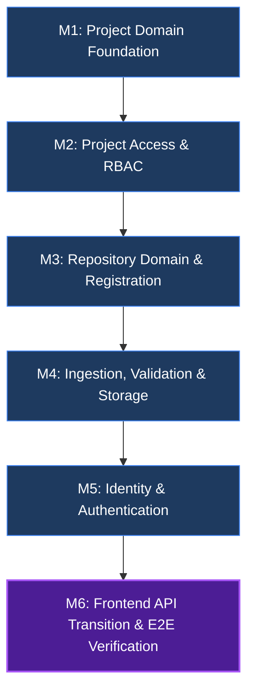

# PROJECT_CONTEXT.md — StackSense Engineering & Migration Context

> **Authoritative Handoff Document**  
> *Maintained under `.agents/skills/planning/SKILL.md` and `.agents/skills/implementing/SKILL.md`*  
> *Last Updated: 2026-10-21*

---

## 1. Project Overview

StackSense is an enterprise-grade PostgreSQL workload intelligence and repository analysis platform.  
The current engineering milestone is **Phase 2: Project & Repository Platform (MERN Backend Migration)**.

The reference implementation of Phase 2 was initially constructed and verified in Python/FastAPI (`backend/`). A complete JavaScript/Express/MongoDB migration is being implemented in `express/` to deliver the MERN architecture stack, alongside the existing React frontend (`frontend/`).

### Authoritative Architecture References
- **`master.txt` (Section 0)**: Current Architectural Baseline & Superseding Decisions.
  - Project is the primary product, domain, ownership, and authorization boundary (`User -> Project -> Repository -> Ingestion`).
  - No `Organization` entity exists as a domain boundary.
  - Resource identities are strictly UUID v4.
  - Role-Based Access Control (RBAC) operates at the Project scope (`OWNER`, `ADMIN`, `DEVELOPER`, `VIEWER`).
- **`master.txt` (Section 25.11)**: Phase 2 — Project & Repository Platform specifications.
- **Reference Implementation**: `backend/platform/identity/`, `backend/platform/projects/`, `backend/platform/repository/`, `backend/api/v1/`.

---

## 2. Global Constraints & Architectural Invariants

1. **Identifier Standard**: All entity IDs (`id` / `_id`, `project_id`, `repository_id`, `ingestion_id`, `user_id`, `token_id`) MUST be valid RFC 4122 UUID v4 strings. Serialized JSON outputs must expose `id` (never expose raw MongoDB ObjectId or unformatted `_id`).
2. **Project-First Isolation**: Projects are independent authorization boundaries. Access to one project never implicitly grants access to another project or its repositories.
3. **No Organization Entity**: No `Organization` or `organization_id` models, routes, or fields may be introduced.
4. **Ownership Model**: Project ownership is determined strictly via `ProjectAccess` records (`role = 'OWNER'`), not an `owner_id` column on the `Project` model.
5. **No Python Backend Modifications**: The Python backend (`backend/`) is complete, frozen, and serves strictly as an immutable reference implementation.
6. **Error Contract**: Express endpoints must return structured JSON error payloads matching:
   ```json
   {
     "error": {
       "code": "error_code_snake_case",
       "message": "Human readable message",
       "details": {}
     }
   }
   ```
7. **Canonical Ingestion Route**: The canonical ingestion endpoint hierarchy is strictly nested:
   `/api/v1/projects/:projectId/repositories/:repositoryId/ingestions`
   Shorthand un-nested routes (e.g. `/repositories/:repositoryId/ingestions`) are prohibited.
8. **Authentication Security Boundary**: Production authentication is exclusively `Authorization: Bearer <access_token>`. Any test-only authentication seams (such as `x-user-id` header injection) are strictly guarded and prohibited in production environments (`NODE_ENV === 'production'`).
9. **No Silent Password Truncation**: Passwords must not be silently truncated. Passwords exceeding the supported bcrypt byte length (72 UTF-8 bytes) must be explicitly rejected with a 422 error.

---

## 3. Phase Index

| Phase | Description | Status | Reference / Location |
| :--- | :--- | :--- | :--- |
| **Phase 1** | Engineering Foundation & Architecture Invariants | Completed | `master.txt` §25.10 |
| **Phase 2** | Project & Repository Platform (Python Reference) | Completed | `backend/` |
| **Phase 2 (MERN)** | Project & Repository Platform (Express/Mongo Migration) | **Active / In Progress** | `express/`, `frontend/` |
| **Phase 3** | Source Understanding & AST Parsing Pipeline | Planned | `master.txt` §25.12+ |

---

## 4. Current Phase Plan: Phase 2 MERN Migration

### 4.1 Objectives
Deliver an enterprise-grade Express/MongoDB implementation of Phase 2 satisfying all requirements of `master.txt` §25.11 and §0, transition the React frontend to proxy the Express backend on port 5000, and verify the complete vertical slice end-to-end.

### 4.2 Module Breakdown & Status



- **M1: Project Domain Foundation** — **STATUS: COMPLETED & VERIFIED** (15 tests passing)
- **M2: Project Access & Resource Boundary (RBAC)** — **STATUS: COMPLETED & VERIFIED** (PR #20 merged)
- **M3: Repository Domain & Registration** — **STATUS: COMPLETED & VERIFIED** (PR #22 reviewed)
- **M4: Repository Ingestion, Validation & Storage** — **STATUS: COMPLETED & VERIFIED** (PR #22 reviewed, 22 suites / 268 tests passing)
- **M5: Main Identity & Authentication** — **STATUS: COMPLETED & VERIFIED** (active-user correction verified; 28 suites / 372 tests passing)
- **M6: Frontend API Transition & Verification** — **STATUS: COMPLETED & VERIFIED** (M6-B1 and M6-B2 complete; Phase 2 closeout remains separate)

---

### 4.3 Detailed Plan: Module 5 (Main Identity & Auth)

#### 4.3.1 Objectives & Invariants
Implement a robust, cryptographically secure Identity & Authentication subsystem in Express matching the verified Python reference implementation:
1. **Public self-registration** (`POST /api/v1/auth/register`): Returns 201 Created. Normalizes email and username (lowercase, trim). Enforces unique database indexes and translates MongoDB duplicate key errors (code 11000) into structured 409 conflict responses.
2. **User authentication** (`POST /api/v1/auth/login`): Supports identifier (email OR username). Uses constant-time dummy verification on nonexistent users to prevent timing-based user enumeration. Returns 200 OK with access and refresh tokens.
3. **Atomic refresh-token rotation** (`POST /api/v1/auth/refresh`): Uses atomic conditional update with query filter `{ token_hash: tokenHash, revoked_at: null, expires_at: { $gt: now } }` and update `$set: { revoked_at: now, replaced_by_token_id: newTokenId }`. Ensures strictly ONE concurrent request can consume an active token. Replay attempts on already-revoked tokens return 401. If replacement creation fails, compensating rollback restores the token.
4. **Session revocation / logout** (`POST /api/v1/auth/logout`): Revokes refresh token session and returns 204 No Content.
5. **Current user profile** (`GET /api/v1/auth/me`): Requires Bearer JWT authentication and returns current user details.
6. **Token Contract & Lifetimes**: Matches Python reference (`backend/platform/config.py`):
   - Access token lifetime: 60 minutes (`expires_in: 3600`).
   - Refresh token lifetime: 30 days (`refresh_expires_in: 2592000`).
   - Canonical user claim: `sub` containing user UUID string. Middleware derives `req.user.id` from `payload.sub`. Tested explicitly against claim mismatch.
7. **Bcrypt Password Policy (No Silent Truncation)**:
   - Validates character length: 8–128 characters.
   - Validates UTF-8 byte length: maximum 72 bytes. Passwords exceeding 72 UTF-8 bytes are rejected with 422 `PasswordPolicyError` (never silently truncated).
   - Bcrypt rounds: 12 (production default), 4 (test mode).
   - Validated against both ASCII and multibyte Unicode strings.
8. **Runtime secret validation**: Fail server startup in production if `JWT_SECRET` or `REFRESH_TOKEN_HMAC_KEY` is missing or shorter than 32 characters. Distinct secrets are enforced for signing and hashing.
9. **Strict production authentication**: In production (`NODE_ENV === 'production'`), only `Authorization: Bearer <access_token>` is recognized. The `x-user-id` header is strictly ignored/rejected outside of test environments (`NODE_ENV === 'test'`).
10. **Preservation of M2 RBAC**: Authentication establishes who the user is (`req.user = { id: payload.sub, email: payload.email }`). M2's `projectAuthorization.js` continues to govern project-scoped capabilities. M5 does not duplicate or bypass M2 logic.

#### 4.3.2 Batch Breakdown for M5

##### M5 — Batch 1: User & RefreshToken Models, Password & Token Services, Runtime Configuration
- **Scope**: Data persistence models, runtime secret validation, and cryptographic services with verified Python parity.
- **Dependencies**: `bcryptjs` (^3.0.3), `jsonwebtoken` (^9.0.3).
- **Files**:
  - `express/package.json`: Add runtime dependencies `bcryptjs` and `jsonwebtoken`.
  - `express/src/config/authConfig.js`: Validate `JWT_SECRET` and `REFRESH_TOKEN_HMAC_KEY` (minimum 32 chars). Enforce strict failure on startup in production if missing. Export token lifetimes (access: 60 min, refresh: 30 days) and bcrypt rounds (12 production, 4 test).
  - `express/src/models/User.js`: Mongoose User schema with UUID v4 primary key, unique indexes on `email` and `username`, `password_hash` with `{ select: false }`, `is_active: true`, timestamps, and JSON transform stripping sensitive fields.
  - `express/src/models/RefreshToken.js`: Mongoose RefreshToken schema with UUID v4 primary key, `user_id`, indexed `token_hash` (HMAC-SHA256), `expires_at`, `revoked_at`, `replaced_by_token_id`, and `isActive` / `isExpired` / `isRevoked` helpers.
  - `express/src/services/auth/passwordService.js`: Bcrypt hashing, 8–128 character policy validation, strict 72-byte UTF-8 ceiling rejection (no silent truncation), constant-time dummy verification for timing attack mitigation.
  - `express/src/services/auth/tokenService.js`: HS256 JWT access token signing (`sub`, `email`, `iat`, `exp`, `jti`, `token_type: "access"`), verification exposing `sub`, and cryptographically secure refresh token generation and HMAC-SHA256 hashing.
  - `express/src/errors/authErrors.js`: Structured domain error classes (`InvalidCredentialsError`, `UserAlreadyExistsError`, `UsernameAlreadyExistsError`, `UserInactiveError`, `InvalidRefreshTokenError`, `RefreshTokenExpiredError`, `RefreshTokenRevokedError`, `InvalidTokenError`, `TokenExpiredError`, `PasswordPolicyError`).
- **Testing**:
  - `express/tests/unit/authConfig.test.js`: Validates configuration requirements and startup failure on missing production secrets.
  - `express/tests/unit/userModel.test.js`: Validates schema, normalization, unique constraints, and JSON serialization.
  - `express/tests/unit/refreshTokenModel.test.js`: Validates model invariants (active, expired, revoked).
  - `express/tests/unit/passwordService.test.js`: Validates policy (8–128 chars, max 72 UTF-8 bytes), rejection of > 72 bytes without silent truncation, multibyte Unicode handling, hashing, verify, and dummy comparison.
  - `express/tests/unit/tokenService.test.js`: Validates HS256 JWT `sub` claim encoding/decoding, expiry (3600s), tampered signature rejection, and deterministic HMAC hashing.

##### M5 — Batch 2: AuthService, Auth Controller & Routes, Atomic Rotation Concurrency
- **Scope**: Application service coordinating auth flows, atomic rotation, HTTP controller, validation, and route mounting.
- **Files**:
  - `express/src/services/auth/authService.js`:
    - `register`: Validates policy, checks duplicate email/username, catches MongoDB duplicate-key errors (code 11000) and maps to structured 409 conflict, saves user with hashed password.
    - `login`: Selects `+password_hash`, executes dummy bcrypt compare on nonexistent user, returns tokens with standard response structure (`access_token`, `refresh_token`, `token_type`, `expires_in: 3600`, `refresh_expires_in: 2592000`).
    - `refreshToken`: Executes **atomic conditional update** with query filter `{ token_hash: tokenHash, revoked_at: null, expires_at: { $gt: now } }` and update `$set: { revoked_at: now, replaced_by_token_id: newTokenId }`. Distinguishes nonexistent (401 `invalid_refresh_token`), revoked (401 `refresh_token_revoked`), and expired (401 `refresh_token_expired`). Implements compensating rollback if replacement insertion fails.
    - `logout`: Revokes token session cleanly.
    - `getCurrentUser`: Resolves active user profile.
  - `express/src/middleware/authValidate.js`: Express validation middleware for auth requests (returns 422 with structured error details).
  - `express/src/controllers/authController.js`: HTTP controller handling endpoints.
  - `express/src/routes/authRoutes.js`: Router mounting `/register`, `/login`, `/refresh`, `/logout`, `/me`.
  - `express/src/routes/index.js`: Mount `authRoutes` under `/api/v1/auth`.
- **Testing**:
  - `express/tests/integration/authApi.test.js`: Integration tests covering:
    - User registration 201 and concurrent duplicate registration 409 (email & username).
    - Login 200 with email and username, 401 on invalid password, 401 on nonexistent user, 403 on inactive account.
    - **Concurrent token rotation test**: Fire two simultaneous refresh requests against the same refresh token (`Promise.all`), verify exactly ONE succeeds with 200 and the other is rejected with 401 (`refresh_token_revoked`).
    - Logout 204 and immediate token invalidation.
    - Profile `/me` 200 with Bearer JWT.

##### M5 — Batch 3: Authenticate Middleware Upgrade, Production Security Guard & Regression
- **Scope**: Upgrade `authenticate.js` to parse and verify Bearer JWT access tokens, derive `req.user.id` from `payload.sub`, enforce production security guard, and verify M2 RBAC integration.
- **Files**:
  - `express/src/middleware/authenticate.js`:
    - Extracts `Authorization: Bearer <token>`. Decodes and verifies signature, expiration, and UUID v4 claims via `tokenService`. Sets `req.user = { id: payload.sub, email: payload.email }`.
    - **Security Guard**: If `process.env.NODE_ENV === 'production'`, `x-user-id` header is strictly ignored/rejected with 401.
    - In test environments (`NODE_ENV === 'test'`), allows `x-user-id` header fallback to support isolated unit/integration suites.
  - `express/src/middleware/errorHandler.js`: Ensure all auth domain errors map to standard status codes.
- **Testing**:
  - `express/tests/unit/authenticate.test.js`: Bearer token verification, `payload.sub` mapping to `req.user.id` test, expired token 401, malformed token 401, test-mode `x-user-id` fallback, and **production rejection test** verifying `x-user-id` is rejected when `NODE_ENV === 'production'`.
  - **M2 RBAC Integration Verification**: Verify that authenticated user identity flows into `projectAuthorization.js` and correctly enforces `OWNER`, `ADMIN`, `DEVELOPER`, and `VIEWER` permissions.
  - **Full Regression**: Execute all 22 existing test suites (268 tests) confirming zero regressions across M1–M4.

---

### 4.4 Current Detailed Plan: M6-B1 Frontend API Integration and Contract Alignment

**Plan status:** Approved and implemented on 2026-10-20. This plan covers M6-B1 only.

#### 4.4.1 Objective, scope, and verified baseline

Connect the existing React UI to the completed Express API without redesigning the UI or changing backend contracts. The runtime frontend already centralizes requests through `frontend/src/services/apiClient.js` and `frontend/src/services/authService.js`; it correctly attaches Bearer tokens, performs one retry after a shared refresh promise, clears credentials only for definitive refresh rejection, preserves Express error codes, and avoids setting JSON content type for `FormData`.

Verified contract gaps:

1. `frontend/vite.config.js` proxies `/api` to Python port 8000, while `express/src/server.js` defaults to port 5000.
2. `frontend/src/services/ingestionService.js` sends GitHub inputs as `repository_url` and `ref`, plus a redundant body `repository_id`. Express `validateStartIngestion` and `ingestionController.triggerIngestion` require only path-scoped identity plus `source_type`, `source_reference`, and optional `revision_identifier`. The existing GitHub handler represents an optional ref as `https://github.com/owner/repo@ref` inside `source_reference`.
3. `AuthContext.restoreSession()` clears stored credentials on every `/auth/me` error, undoing `apiClient`'s intended preservation for network and 5xx failures.
4. Existing frontend tests pass but encode the incompatible GitHub payload and do not verify the Vite target, generic Express error details, or multipart field/header behavior.

Verified as already compatible and therefore reused without application changes: auth endpoint paths and login/register/logout/me payloads; project and repository paths/payloads; ingestion/revision/artifact paths; raw array response consumption; 204 handling; Express structured errors; refresh rotation fields; multipart endpoint and `file`/`revision_identifier` field names; Bearer attachment; refresh deduplication; retry-loop prevention; and the existing Express CORS behavior. No Express source change is planned because the Vite proxy is same-origin in development and the inspected frontend contracts can conform to Express.

#### 4.4.2 M6-B1 implementation batches

##### M6-B1.1 — Development routing and ingestion request alignment

- Modify `frontend/vite.config.js`: point only the existing `/api` proxy from `http://localhost:8000` to `http://localhost:5000`; retain `changeOrigin` and the current frontend port/host settings.
- Modify `frontend/src/services/ingestionService.js`:
  - keep every canonical nested endpoint unchanged;
  - emit only `source_type`, `source_reference`, and optional `revision_identifier` for JSON ingestion requests;
  - map GitHub URL plus optional ref into Express's canonical `source_reference` representation (`URL` or `URL@ref`);
  - remove redundant `repository_id`, `repository_url`, and `ref` wire fields;
  - keep multipart upload as `FormData` with `file` and optional `revision_identifier`, allowing the browser to set the boundary.

##### M6-B1.2 — Session restoration consistency

- Modify `frontend/src/auth/AuthContext.jsx`: during initial `/auth/me` restoration, clear the session only for definitive session failures: any 401 response, or the explicit 403 `user_inactive` contract. Preserve stored tokens for unrelated 403 authorization failures, status `0` network failures, and 5xx/transient failures; record the error and finish loading without dispatching a second expiry path. Do not change login, registration, logout, routing, or refresh ownership.
- Modify `frontend/src/services/authService.js`: expose the small, testable definitive-session-failure policy consumed by `AuthContext`; leave endpoint behavior unchanged.
- Reuse `frontend/src/services/apiClient.js` unchanged unless implementation proves a test-visible defect; current code already satisfies Bearer, refresh concurrency, retry, network preservation, and structured-error contracts.

##### M6-B1.3 — Frontend contract regression coverage

- Modify `frontend/tests/m6Flows.test.js` using its existing Node/assert harness:
  - assert the Vite proxy targets port 5000;
  - update GitHub ingestion expectations to the canonical `source_reference` body and verify optional ref composition;
  - assert JSON ingestion omits redundant path identity fields;
  - exercise remaining get/update/delete service paths where needed to cover the actual route table;
  - assert multipart upload uses `/ingestions/upload`, includes `file` and optional `revision_identifier`, carries Bearer auth, and does not manually set `Content-Type`;
  - assert generic Express `{ error: { code, message, details } }` becomes `ApiError` without losing details;
  - add restoration-policy assertions proving 401 and `403 user_inactive` are definitive, while unrelated 403, network, and 5xx failures preserve credentials;
  - retain the existing concurrent-401, one-refresh, one-retry, refresh-failure, and transient-failure tests.
- Reuse `frontend/tests/authApi.test.js` as an unchanged regression suite. `frontend/src/api/authApi.js` has no runtime imports; deleting or consolidating this legacy client is not necessary for M6-B1 and is deferred rather than mixed into contract migration.

#### 4.4.3 File-level specifications

| Path | Action | Responsibility and rationale | Verification |
| :--- | :--- | :--- | :--- |
| `frontend/vite.config.js` | Modify | Route development `/api` traffic to the actual Express default port 5000. | Proxy-target assertion; development smoke check if practical. |
| `frontend/src/services/ingestionService.js` | Modify | Translate existing UI inputs into the established Express ingestion DTO and retain canonical nested routes/multipart behavior. | JSON body/path assertions, GitHub ref cases, multipart assertions. |
| `frontend/src/auth/AuthContext.jsx` | Modify | Make initial session restoration follow the same definitive-versus-transient failure policy as `apiClient`. | 401/403 clearing and network/5xx preservation assertions. |
| `frontend/tests/m6Flows.test.js` | Modify | Extend the existing runtime-client/service contract suite; replace the currently incorrect GitHub expectation. | `npm test`. |
| `frontend/src/services/apiClient.js` | Reuse | Existing centralized transport already implements required auth, retry, FormData, and error behavior. | Existing and extended `m6Flows` tests. |
| `frontend/src/services/authService.js` | Modify | Keep the compatible M5 endpoint behavior and expose the definitive restoration-failure policy used by `AuthContext`. | Direct policy assertions in `m6Flows.test.js`. |
| `frontend/src/services/projectService.js` | Reuse | Project paths and request bodies match Express. | Expanded path/payload assertions. |
| `frontend/src/services/repositoryService.js` | Reuse | Repository paths and request bodies match Express. | Expanded path/payload assertions. |
| `express/src/app.js` and Express route/controller files | Reuse | Backend contract is authoritative and already compatible after frontend translation; same-origin Vite proxy does not require a CORS change. | Existing Express suite; no source diff expected. |

No files are created or deleted, and no dependency change is planned.

#### 4.4.4 Testing and quality gates

1. Baseline already executed during planning: `cd frontend && npm test` — passed both configured scripts; this proves only the current mocked expectations, not Express compatibility.
2. After implementation: `cd frontend && npm test` — all existing and new contract assertions pass.
3. After implementation: `cd frontend && npm run build` — Vite production build completes cleanly.
4. After implementation: targeted Express contract regression, at minimum `authApi.test.js`, `projectApi.test.js`, `repositoryApi.test.js`, and `ingestionApi.test.js`; then `cd express && npm test` if practical.
5. Optional manual development smoke check (not a substitute for M6-B2): run Express on 5000 and Vite on 3000, confirm `/api/v1/health` traverses the proxy and one login/current-user request reaches Express. Do not execute the complete vertical slice in M6-B1.

#### 4.4.5 Acceptance criteria

1. Vite development `/api` requests target Express on port 5000; no active frontend API configuration targets port 8000.
2. Existing registration, login, logout, current-user, project, repository, ingestion, revision, and artifact screens continue using the existing UI and canonical `/api/v1` routes.
3. Protected requests carry the access token; concurrent 401s cause exactly one refresh; each original request retries at most once.
4. Refresh 401/403 clears tokens and emits `auth:expired`; refresh network/5xx failures preserve tokens and semantic Express errors remain available to callers.
5. Initial session restoration preserves credentials on unrelated 403, network, and 5xx failures; it clears them only for 401 responses or explicit `403 user_inactive`.
6. GitHub ingestion sends Express-compatible `source_reference`, including optional ref encoding; server-path ingestion remains compatible.
7. Archive upload sends `file` and optional `revision_identifier` as multipart data without a manually supplied content type.
8. Express structured errors retain status, code, message, and details in frontend `ApiError` objects.
9. Frontend tests and production build pass; relevant Express contract tests remain green.
10. No Express contract, Python file, React visual design, dependency, M6-B2 E2E workflow, or Phase 2 closeout work is changed.

#### 4.4.6 Risks and unresolved items

- `frontend/src/api/authApi.js` duplicates part of the runtime auth stack but is not imported by application code. Consolidation is a maintenance improvement, not required for M6-B1, and is explicitly deferred.
- `ProjectCard` defaults absent `project.role` to `OWNER`, while both Python and Express `ProjectResponse` omit a role field. This can display inaccurate role badges/actions for non-owners, although Express still enforces M2 RBAC. Adding a role to the backend response is not authorized by the current contract; record this for a separate contract/product decision rather than silently changing Express during M6-B1.
- The Node-based frontend harness mocks transport and does not prove a live browser-to-Express journey. That limitation is intentionally closed by M6-B2, not by expanding this batch.

#### 4.4.7 M6-B1 execution record

- **Status:** Complete (2026-10-20).
- **Completed work:** Vite now proxies `/api` to Express port 5000. JSON ingestion requests match Express's validated DTO for all three canonical sources: GitHub uses `URL` or `URL@ref`; archive and server-path modes pass their server-side path as `source_reference`; path identity remains in the route. Multipart upload remains on `/ingestions/upload`. Session restoration now evicts credentials only for 401 or `403 user_inactive`, preserving them for unrelated authorization, network, and transient server failures.
- **Files changed:** `frontend/vite.config.js`, `frontend/src/services/ingestionService.js`, `frontend/src/services/authService.js`, `frontend/src/auth/AuthContext.jsx`, and `frontend/tests/m6Flows.test.js`.
- **Tests updated:** Added proxy, canonical ingestion DTO, all canonical source modes, multipart boundary/auth, structured-error detail, and session-failure policy assertions. Existing Bearer, refresh deduplication, one-retry, and transient-refresh tests remain intact.
- **Verification:** `cd frontend && npm test` passed; `cd frontend && npm run build` passed (56 modules); targeted Express suites `authApi.test.js`, `projectApi.test.js`, `repositoryApi.test.js`, and `ingestionApi.test.js` passed (4 suites / 100 tests). The first sandboxed Express attempt could not bind the MongoMemoryServer port (`EPERM`); rerunning with local-port permission passed.
- **Deviation:** The approved clarification required a minimal `authService.js` policy export so the distinction between `403 user_inactive` and unrelated 403 responses is directly testable. No endpoint behavior or `apiClient.js` behavior changed.
- **Outstanding work:** None for M6-B1. M6-B2 and live end-to-end verification remain explicitly separate.

### 4.5 M6-B2 End-to-End Product Flow Verification

- **Status:** Complete (2026-10-21).
- **Implementation:** Added `express/tests/integration/e2eVerticalSlice.test.js`, using the real Express app, MongoMemoryServer database, Bearer authentication middleware, project-scoped RBAC, archive acquisition/extraction, artifact classification, content-addressable storage, and canonical nested routes.
- **Verified journey:** Register (201) → login (200) → authenticated project creation (201) → nested repository registration (201) → archive ingestion trigger (201) → bounded polling of the canonical ingestion status endpoint → terminal `completed` → revision listing → classified artifact listing → refresh-token rotation (200) → `/auth/me` with the rotated access token (200) → logout (204) → rejected replay of the revoked refresh token (401 `refresh_token_revoked`).
- **Polling behavior:** Polls at a bounded interval with a finite timeout; returns only on `completed`, fails immediately with `error_code` and `error_message` on `failed`, and reports the ingestion ID plus last observed status on timeout.
- **Fixture isolation:** Uses a unique temporary archive and temporary storage root, removed after the suite. External GitHub access is not required or mocked; the supported archive source exercises the complete ingestion pipeline deterministically.
- **Verification:** Targeted E2E passed (1 suite / 1 test). Full Express regression passed (29 suites / 373 tests). Frontend tests passed. Frontend production build passed (56 modules).
- **Limitations:** This is an HTTP-level end-to-end integration test through the real Express application, not browser automation. Existing frontend service-contract tests verify the React API boundary; no UI redesign or browser harness was introduced.
- **Outstanding work:** None for M6-B2. Phase 2 closeout and architecture-compliance review remain separate and unstarted.

---

## 5. File-by-File Specifications

| Path | Action | Responsibilities | Key Dependencies & Contracts | Tests |
| :--- | :--- | :--- | :--- | :--- |
| `express/package.json` | Modify | Add `bcryptjs` and `jsonwebtoken` runtime dependencies | `bcryptjs`, `jsonwebtoken` | Package lock integrity |
| `express/src/config/authConfig.js` | Create | Validate runtime secrets (`JWT_SECRET`, `REFRESH_TOKEN_HMAC_KEY`), fail in production if invalid/missing, export lifetimes (60m / 30d) and bcrypt rounds | `dotenv` | `authConfig.test.js` |
| `express/src/models/User.js` | Create | User Mongoose model (UUID v4, unique lowercase email/username, hidden password_hash, is_active, JSON transform) | `mongoose`, `uuid` | `userModel.test.js` |
| `express/src/models/RefreshToken.js` | Create | RefreshToken Mongoose model (UUID v4, user_id, HMAC token_hash, expires_at, revoked_at, replaced_by_token_id) | `mongoose`, `uuid` | `refreshTokenModel.test.js` |
| `express/src/services/auth/passwordService.js` | Create | Bcrypt hashing (12 rounds), 8–128 character policy validation, 72-byte ceiling rejection without silent truncation, dummy comparison | `bcryptjs` | `passwordService.test.js` |
| `express/src/services/auth/tokenService.js` | Create | HS256 JWT access token signing/verification (`sub` claim) and HMAC-SHA256 refresh token hashing | `jsonwebtoken`, `crypto`, `uuid` | `tokenService.test.js` |
| `express/src/errors/authErrors.js` | Create | Structured domain error classes with HTTP status codes and semantic error codes | Error base class | Unit & error handler tests |
| `express/src/services/auth/authService.js` | Create | Application service with atomic refresh token rotation (`findOneAndUpdate` on `token_hash`), duplicate registration race handling, and logout | `User`, `RefreshToken`, services | Service & API tests |
| `express/src/middleware/authValidate.js` | Create | Input validation for `/register`, `/login`, `/refresh`, `/logout` payloads (422 status) | Express middleware | API integration tests |
| `express/src/controllers/authController.js` | Create | HTTP controller translating HTTP requests to `authService` invocations and responses | `authService` | `authApi.test.js` |
| `express/src/routes/authRoutes.js` | Create | Route definitions for `/api/v1/auth` endpoints | Express Router | `authApi.test.js` |
| `express/src/routes/index.js` | Modify | Mount `/auth` routes under `/api/v1` | `authRoutes` | Health and API tests |
| `express/src/middleware/authenticate.js` | Modify | Validate Bearer JWTs, derive `req.user.id` from `payload.sub`, strictly reject `x-user-id` in production, allow only in test | `tokenService` | `authenticate.test.js` |
| `express/src/middleware/errorHandler.js` | Modify | Map auth domain errors to appropriate HTTP status codes (401, 403, 409, 422) | Error classes | Integration tests |
| `frontend/vite.config.js` | Modify | Update `/api` proxy target from port 8000 to port 5000 | Vite config | `npm test` & dev server |
| `frontend/src/services/ingestionService.js` | Modify | Translate GitHub URL/ref inputs to canonical Express `source_reference`; keep nested paths and multipart contract | `apiClient`, Express ingestion DTO | `m6Flows.test.js` service/body assertions |
| `frontend/src/auth/AuthContext.jsx` | Modify | Preserve stored credentials on transient restoration failures; clear only on definitive auth rejection | `authService`, `tokenStorage` | `m6Flows.test.js` restoration-policy assertions |
| `frontend/tests/m6Flows.test.js` | Modify | Correct and extend proxy, service, error, session, and multipart contract coverage | Node assert/fetch/FormData harness | `npm test` |
| `express/src/app.js` | Reuse | Current CORS does not require an M6-B1 change because Vite proxies same-origin `/api` traffic | `cors` | Existing Express integration suite |
| `express/tests/integration/e2eVerticalSlice.test.js` | Create | End-to-end integration test with deterministic bounded polling for ingestion completion | Supertest, Jest | E2E test execution |

---

## 6. Execution Ledger

| Module / Batch | Description | Status | Evidence / Verification |
| :--- | :--- | :--- | :--- |
| **M1 Batch 1** | Express foundation, DB connection, health API | **Passed** | 3 tests passed |
| **M1 Batch 2** | Project model & service layer | **Passed** | 12 tests passed |
| **M1 Batch 3** | Project API routes, validation & error handling | **Passed** | 22 tests passed |
| **M2 (All)** | Project Access model, service, RBAC & routes | **Passed** | PR #20 merged |
| **M3 (All)** | Repository model, service & routes | **Passed** | PR #22 verified |
| **M4 (All)** | Ingestion, acquisition handlers, storage & validation | **Passed** | PR #22 verified (22 suites / 268 tests passed) |
| **M5 Batch 1** | User & RefreshToken models, Password & Token services, AuthConfig | **Passed** | 5 suites / 56 tests passed (review follow-ups resolved) |
| **M5 Batch 2** | AuthService, Auth Controller & Routes, Atomic Rotation | **Passed** | 36 auth integration tests passed, including inactive/deleted-user rejection |
| **M5 Batch 3** | Authenticate middleware upgrade, Production Guard & Regression | **Passed** | 18 middleware tests passed; active-user revalidation, prod guard, RBAC integration, and full Express regression verified (28 suites / 372 tests) |
| **M6 Batch 1** | Frontend API integration & contract alignment | **Complete** | Frontend tests/build passed; targeted Express contract regression passed (4 suites / 100 tests) |
| **M6 Batch 2** | E2E vertical slice validation & production build | **Complete** | Real Express vertical slice passed; full Express 29 suites / 373 tests; frontend tests/build passed |
| **Dashboard & Artifacts** | Repo search, 5/page pagination, 3-dot deletion, ArtifactsTab revisions fix | **Complete** | Frontend tests passed (3 suites / 100%), build passed; Express 29 suites / 377 tests passed |
| **Phase 2 Closeout**| Evaluation 1 readiness, architectural compliance & freeze | Planned | Tracked until all acceptance criteria verified |

---

## 7. Decisions and Risks

### Approved Decisions
1. **Password Hashing via `bcryptjs`**: Use pure JavaScript `bcryptjs` with 12 rounds (4 in tests) and strict 72 UTF-8 byte rejection (no silent truncation).
2. **User Credential Co-location**: In MongoDB, embed `password_hash` directly on the `User` document with `{ select: false }`. Never serialize `password_hash` in API responses.
3. **Stateful Refresh Tokens with HMAC-SHA256**: Store only the HMAC-SHA256 hash of refresh tokens in MongoDB.
4. **Atomic Token Rotation**: Use `findOneAndUpdate` with query filter `{ token_hash: tokenHash, revoked_at: null, expires_at: { $gt: now } }` and update `$set: { revoked_at: now, replaced_by_token_id: newTokenId }`. Ensures strictly single-use consumption even under concurrent requests. If replacement insertion fails, compensating update rolls back revocation.
5. **Separate Secrets & Lifetimes**: Enforce distinct `JWT_SECRET` (for signing) and `REFRESH_TOKEN_HMAC_KEY` (for HMAC hashing) validated at runtime startup. Lifetimes match Python reference defaults: 60 minutes for access tokens, 30 days for refresh tokens.
6. **Canonical JWT Claim**: The canonical user ID claim is `sub` (RFC 7519). `authenticate.js` derives `req.user.id` from `payload.sub`. Tested explicitly against claim naming mismatches.
7. **Strict Production Authentication**: In production (`NODE_ENV === 'production'`), only `Authorization: Bearer <access_token>` is accepted. Any test seam (`x-user-id`) is strictly guarded and disallowed in production.
8. **Canonical Ingestion Route**: The canonical endpoint is strictly `/api/v1/projects/:projectId/repositories/:repositoryId/ingestions` with explicit route parameter names. Shorthand un-nested routes are prohibited.
9. **Deterministic Terminal Polling**: E2E tests poll ingestion status until either terminal status (`completed` or `failed`) is reached. `completed` succeeds; `failed` immediately reports the ingestion error.
10. **Active-User Revalidation**: Every Bearer-authenticated request verifies the JWT first, then resolves `sub` to the authoritative User record. Missing users are rejected with `invalid_token`; inactive users are rejected with `user_inactive`. Request identity fields come from the validated User record, while M2 remains the authority for project-scoped permissions.
11. **Repository Deletion & Active Ingestion Safety**: Repository deletion endpoint (`DELETE /api/v1/projects/:projectId/repositories/:repositoryId`) verifies project boundary, blocks deletion if an ingestion is actively `PROCESSING` (409 conflict), and triggers defensive cascade cleanup of child ingestions, revisions, and artifacts through Mongoose hooks while preserving content-addressed physical storage objects.
12. **ArtifactsTab Revisions Decoupling**: Revisions list fetching depends strictly on `[projectId, repositoryId]` identity via refs, avoiding re-fetching when `selectedRevision` changes. Artifacts loading depends on the primitive `selectedRevisionId` string.

### Approved M6-B1 Decisions

1. Keep Express contracts unchanged and translate the existing GitHub UI inputs inside `ingestionService` to canonical `source_reference`.
2. Preserve session credentials for unrelated 403, status `0`, and 5xx restoration failures; clear only for 401 or explicit `403 user_inactive`.
3. Keep CORS unchanged for M6-B1 because the Vite development proxy maintains a same-origin browser contract.
4. Retain the unused legacy `src/api/authApi.js` during this scoped migration; consolidation is separate cleanup.

### Risks & Mitigations
- **Concurrent Duplicate Registrations**: Simultaneous requests with identical emails or usernames could pass application checks.  
  *Mitigation*: Enforce unique MongoDB indexes and translate error code 11000 into structured 409 conflict responses.
- **Asynchronous Ingestion Timing Flakes**: Tests relying on arbitrary delays could flake or mask background failures.  
  *Mitigation*: Use deterministic bounded polling in E2E tests, asserting terminal status `completed` or failing immediately on `failed`.
- **Port & Cross-Origin Ambiguity**: Dev proxy vs production direct access.  
  *Mitigation*: Change the existing Vite proxy target to Express port 5000. Cross-origin configuration is not changed because browser API calls remain same-origin through `/api`.

---

## 8. Current Handoff

- **Current Stage**: Phase 2 MERN Migration — Dashboard Repository Management (Search, 5/page Pagination, 3-dot Deletion) & Artifacts Tab Optimization Complete.
- **Verification Evidence**:
  - `frontend`: `npm test` passed 100% across all 3 suites (`authApi.test.js`, `m6Flows.test.js`, `repositoryManagementAndArtifacts.test.js`).
  - `frontend`: `npm run build` completed cleanly without errors.
  - `express`: `npm test` (`jest --runInBand`) passed 100% across all 29 suites (377 tests).
- **Next Recommended Action**: Proceed with Phase 2 closeout or next milestone per roadmap.
