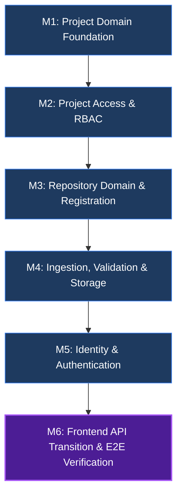

# PROJECT_CONTEXT.md — StackSense Engineering & Migration Context

> **Authoritative Handoff Document**  
> *Maintained under `.agents/skills/planning/SKILL.md` and `.agents/skills/implementing/SKILL.md`*  
> *Last Updated: 2026-10-19*

---

## 1. Project Overview

StackSense is an enterprise-grade PostgreSQL workload intelligence and repository analysis platform.  
The current engineering milestone is **Phase 2: Project & Repository Platform (MERN Backend Migration)**.

The reference implementation of Phase 2 was initially constructed and verified in Python/FastAPI (`backend/`). A complete JavaScript/Express/MongoDB migration is being implemented in `express/` to deliver the MERN architecture stack, alongside the existing React frontend (`frontend/`).

### Authoritative Architecture References
- **`master.txt` (Section 0)**: Current Architectural Baseline & Superseding Decisions.
  - Project is the primary product, domain, ownership, and authorization boundary (`User -> Project -> Repository -> Ingestion`).
  - No `Organization` entity exists as a domain boundary.
  - Resource identities are strictly UUID v4.
  - Role-Based Access Control (RBAC) operates at the Project scope (`OWNER`, `ADMIN`, `DEVELOPER`, `VIEWER`).
- **`master.txt` (Section 25.11)**: Phase 2 — Project & Repository Platform specifications.
- **Reference Implementation**: `backend/platform/identity/`, `backend/platform/projects/`, `backend/platform/repository/`, `backend/api/v1/`.

---

## 2. Global Constraints & Architectural Invariants

1. **Identifier Standard**: All entity IDs (`id` / `_id`, `project_id`, `repository_id`, `ingestion_id`, `user_id`, `token_id`) MUST be valid RFC 4122 UUID v4 strings. Serialized JSON outputs must expose `id` (never expose raw MongoDB ObjectId or unformatted `_id`).
2. **Project-First Isolation**: Projects are independent authorization boundaries. Access to one project never implicitly grants access to another project or its repositories.
3. **No Organization Entity**: No `Organization` or `organization_id` models, routes, or fields may be introduced.
4. **Ownership Model**: Project ownership is determined strictly via `ProjectAccess` records (`role = 'OWNER'`), not an `owner_id` column on the `Project` model.
5. **No Python Backend Modifications**: The Python backend (`backend/`) is complete, frozen, and serves strictly as an immutable reference implementation.
6. **Error Contract**: Express endpoints must return structured JSON error payloads matching:
   ```json
   {
     "error": {
       "code": "error_code_snake_case",
       "message": "Human readable message",
       "details": {}
     }
   }
   ```
7. **Canonical Ingestion Route**: The canonical ingestion endpoint hierarchy is strictly nested:
   `/api/v1/projects/:projectId/repositories/:repositoryId/ingestions`
   Shorthand un-nested routes (e.g. `/repositories/:repositoryId/ingestions`) are prohibited.
8. **Authentication Security Boundary**: Production authentication is exclusively `Authorization: Bearer <access_token>`. Any test-only authentication seams (such as `x-user-id` header injection) are strictly guarded and prohibited in production environments (`NODE_ENV === 'production'`).
9. **No Silent Password Truncation**: Passwords must not be silently truncated. Passwords exceeding the supported bcrypt byte length (72 UTF-8 bytes) must be explicitly rejected with a 422 error.

---

## 3. Phase Index

| Phase | Description | Status | Reference / Location |
| :--- | :--- | :--- | :--- |
| **Phase 1** | Engineering Foundation & Architecture Invariants | Completed | `master.txt` §25.10 |
| **Phase 2** | Project & Repository Platform (Python Reference) | Completed | `backend/` |
| **Phase 2 (MERN)** | Project & Repository Platform (Express/Mongo Migration) | **Active / In Progress** | `express/`, `frontend/` |
| **Phase 3** | Source Understanding & AST Parsing Pipeline | Planned | `master.txt` §25.12+ |

---

## 4. Current Phase Plan: Phase 2 MERN Migration

### 4.1 Objectives
Deliver an enterprise-grade Express/MongoDB implementation of Phase 2 satisfying all requirements of `master.txt` §25.11 and §0, transition the React frontend to proxy the Express backend on port 5000, and verify the complete vertical slice end-to-end.

### 4.2 Module Breakdown & Status



- **M1: Project Domain Foundation** — **STATUS: COMPLETED & VERIFIED** (15 tests passing)
- **M2: Project Access & Resource Boundary (RBAC)** — **STATUS: COMPLETED & VERIFIED** (PR #20 merged)
- **M3: Repository Domain & Registration** — **STATUS: COMPLETED & VERIFIED** (PR #22 reviewed)
- **M4: Repository Ingestion, Validation & Storage** — **STATUS: COMPLETED & VERIFIED** (PR #22 reviewed, 22 suites / 268 tests passing)
- **M5: Main Identity & Authentication** — **STATUS: COMPLETED & VERIFIED** (All 3 Batches verified, 28 suites / 367 tests passing)
- **M6: Frontend API Transition & Verification** — **STATUS: PLANNED (REFINED & READY FOR EXECUTION)**

---

### 4.3 Detailed Plan: Module 5 (Main Identity & Auth)

#### 4.3.1 Objectives & Invariants
Implement a robust, cryptographically secure Identity & Authentication subsystem in Express matching the verified Python reference implementation:
1. **Public self-registration** (`POST /api/v1/auth/register`): Returns 201 Created. Normalizes email and username (lowercase, trim). Enforces unique database indexes and translates MongoDB duplicate key errors (code 11000) into structured 409 conflict responses.
2. **User authentication** (`POST /api/v1/auth/login`): Supports identifier (email OR username). Uses constant-time dummy verification on nonexistent users to prevent timing-based user enumeration. Returns 200 OK with access and refresh tokens.
3. **Atomic refresh-token rotation** (`POST /api/v1/auth/refresh`): Uses atomic conditional update with query filter `{ token_hash: tokenHash, revoked_at: null, expires_at: { $gt: now } }` and update `$set: { revoked_at: now, replaced_by_token_id: newTokenId }`. Ensures strictly ONE concurrent request can consume an active token. Replay attempts on already-revoked tokens return 401. If replacement creation fails, compensating rollback restores the token.
4. **Session revocation / logout** (`POST /api/v1/auth/logout`): Revokes refresh token session and returns 204 No Content.
5. **Current user profile** (`GET /api/v1/auth/me`): Requires Bearer JWT authentication and returns current user details.
6. **Token Contract & Lifetimes**: Matches Python reference (`backend/platform/config.py`):
   - Access token lifetime: 60 minutes (`expires_in: 3600`).
   - Refresh token lifetime: 30 days (`refresh_expires_in: 2592000`).
   - Canonical user claim: `sub` containing user UUID string. Middleware derives `req.user.id` from `payload.sub`. Tested explicitly against claim mismatch.
7. **Bcrypt Password Policy (No Silent Truncation)**:
   - Validates character length: 8–128 characters.
   - Validates UTF-8 byte length: maximum 72 bytes. Passwords exceeding 72 UTF-8 bytes are rejected with 422 `PasswordPolicyError` (never silently truncated).
   - Bcrypt rounds: 12 (production default), 4 (test mode).
   - Validated against both ASCII and multibyte Unicode strings.
8. **Runtime secret validation**: Fail server startup in production if `JWT_SECRET` or `REFRESH_TOKEN_HMAC_KEY` is missing or shorter than 32 characters. Distinct secrets are enforced for signing and hashing.
9. **Strict production authentication**: In production (`NODE_ENV === 'production'`), only `Authorization: Bearer <access_token>` is recognized. The `x-user-id` header is strictly ignored/rejected outside of test environments (`NODE_ENV === 'test'`).
10. **Preservation of M2 RBAC**: Authentication establishes who the user is (`req.user = { id: payload.sub, email: payload.email }`). M2's `projectAuthorization.js` continues to govern project-scoped capabilities. M5 does not duplicate or bypass M2 logic.

#### 4.3.2 Batch Breakdown for M5

##### M5 — Batch 1: User & RefreshToken Models, Password & Token Services, Runtime Configuration
- **Scope**: Data persistence models, runtime secret validation, and cryptographic services with verified Python parity.
- **Dependencies**: `bcryptjs` (^3.0.3), `jsonwebtoken` (^9.0.3).
- **Files**:
  - `express/package.json`: Add runtime dependencies `bcryptjs` and `jsonwebtoken`.
  - `express/src/config/authConfig.js`: Validate `JWT_SECRET` and `REFRESH_TOKEN_HMAC_KEY` (minimum 32 chars). Enforce strict failure on startup in production if missing. Export token lifetimes (access: 60 min, refresh: 30 days) and bcrypt rounds (12 production, 4 test).
  - `express/src/models/User.js`: Mongoose User schema with UUID v4 primary key, unique indexes on `email` and `username`, `password_hash` with `{ select: false }`, `is_active: true`, timestamps, and JSON transform stripping sensitive fields.
  - `express/src/models/RefreshToken.js`: Mongoose RefreshToken schema with UUID v4 primary key, `user_id`, indexed `token_hash` (HMAC-SHA256), `expires_at`, `revoked_at`, `replaced_by_token_id`, and `isActive` / `isExpired` / `isRevoked` helpers.
  - `express/src/services/auth/passwordService.js`: Bcrypt hashing, 8–128 character policy validation, strict 72-byte UTF-8 ceiling rejection (no silent truncation), constant-time dummy verification for timing attack mitigation.
  - `express/src/services/auth/tokenService.js`: HS256 JWT access token signing (`sub`, `email`, `iat`, `exp`, `jti`, `token_type: "access"`), verification exposing `sub`, and cryptographically secure refresh token generation and HMAC-SHA256 hashing.
  - `express/src/errors/authErrors.js`: Structured domain error classes (`InvalidCredentialsError`, `UserAlreadyExistsError`, `UsernameAlreadyExistsError`, `UserInactiveError`, `InvalidRefreshTokenError`, `RefreshTokenExpiredError`, `RefreshTokenRevokedError`, `InvalidTokenError`, `TokenExpiredError`, `PasswordPolicyError`).
- **Testing**:
  - `express/tests/unit/authConfig.test.js`: Validates configuration requirements and startup failure on missing production secrets.
  - `express/tests/unit/userModel.test.js`: Validates schema, normalization, unique constraints, and JSON serialization.
  - `express/tests/unit/refreshTokenModel.test.js`: Validates model invariants (active, expired, revoked).
  - `express/tests/unit/passwordService.test.js`: Validates policy (8–128 chars, max 72 UTF-8 bytes), rejection of > 72 bytes without silent truncation, multibyte Unicode handling, hashing, verify, and dummy comparison.
  - `express/tests/unit/tokenService.test.js`: Validates HS256 JWT `sub` claim encoding/decoding, expiry (3600s), tampered signature rejection, and deterministic HMAC hashing.

##### M5 — Batch 2: AuthService, Auth Controller & Routes, Atomic Rotation Concurrency
- **Scope**: Application service coordinating auth flows, atomic rotation, HTTP controller, validation, and route mounting.
- **Files**:
  - `express/src/services/auth/authService.js`:
    - `register`: Validates policy, checks duplicate email/username, catches MongoDB duplicate-key errors (code 11000) and maps to structured 409 conflict, saves user with hashed password.
    - `login`: Selects `+password_hash`, executes dummy bcrypt compare on nonexistent user, returns tokens with standard response structure (`access_token`, `refresh_token`, `token_type`, `expires_in: 3600`, `refresh_expires_in: 2592000`).
    - `refreshToken`: Executes **atomic conditional update** with query filter `{ token_hash: tokenHash, revoked_at: null, expires_at: { $gt: now } }` and update `$set: { revoked_at: now, replaced_by_token_id: newTokenId }`. Distinguishes nonexistent (401 `invalid_refresh_token`), revoked (401 `refresh_token_revoked`), and expired (401 `refresh_token_expired`). Implements compensating rollback if replacement insertion fails.
    - `logout`: Revokes token session cleanly.
    - `getCurrentUser`: Resolves active user profile.
  - `express/src/middleware/authValidate.js`: Express validation middleware for auth requests (returns 422 with structured error details).
  - `express/src/controllers/authController.js`: HTTP controller handling endpoints.
  - `express/src/routes/authRoutes.js`: Router mounting `/register`, `/login`, `/refresh`, `/logout`, `/me`.
  - `express/src/routes/index.js`: Mount `authRoutes` under `/api/v1/auth`.
- **Testing**:
  - `express/tests/integration/authApi.test.js`: Integration tests covering:
    - User registration 201 and concurrent duplicate registration 409 (email & username).
    - Login 200 with email and username, 401 on invalid password, 401 on nonexistent user, 403 on inactive account.
    - **Concurrent token rotation test**: Fire two simultaneous refresh requests against the same refresh token (`Promise.all`), verify exactly ONE succeeds with 200 and the other is rejected with 401 (`refresh_token_revoked`).
    - Logout 204 and immediate token invalidation.
    - Profile `/me` 200 with Bearer JWT.

##### M5 — Batch 3: Authenticate Middleware Upgrade, Production Security Guard & Regression
- **Scope**: Upgrade `authenticate.js` to parse and verify Bearer JWT access tokens, derive `req.user.id` from `payload.sub`, enforce production security guard, and verify M2 RBAC integration.
- **Files**:
  - `express/src/middleware/authenticate.js`:
    - Extracts `Authorization: Bearer <token>`. Decodes and verifies signature, expiration, and UUID v4 claims via `tokenService`. Sets `req.user = { id: payload.sub, email: payload.email }`.
    - **Security Guard**: If `process.env.NODE_ENV === 'production'`, `x-user-id` header is strictly ignored/rejected with 401.
    - In test environments (`NODE_ENV === 'test'`), allows `x-user-id` header fallback to support isolated unit/integration suites.
  - `express/src/middleware/errorHandler.js`: Ensure all auth domain errors map to standard status codes.
- **Testing**:
  - `express/tests/unit/authenticate.test.js`: Bearer token verification, `payload.sub` mapping to `req.user.id` test, expired token 401, malformed token 401, test-mode `x-user-id` fallback, and **production rejection test** verifying `x-user-id` is rejected when `NODE_ENV === 'production'`.
  - **M2 RBAC Integration Verification**: Verify that authenticated user identity flows into `projectAuthorization.js` and correctly enforces `OWNER`, `ADMIN`, `DEVELOPER`, and `VIEWER` permissions.
  - **Full Regression**: Execute all 22 existing test suites (268 tests) confirming zero regressions across M1–M4.

---

### 4.4 Detailed Plan: Module 6 (Frontend API Transition & Verification)

#### 4.4.1 Objectives & Contract Resolution
1. **Endpoint Resolution**: All ingestion routes use the established canonical contract:
   `POST /api/v1/projects/:projectId/repositories/:repositoryId/ingestions` (returns 201 Created)
   `GET /api/v1/projects/:projectId/repositories/:repositoryId/ingestions/:ingestionId` (returns 200 OK)
   Explicit parameter names (`projectId`, `repositoryId`) are strictly enforced. Shorthand un-nested routes are prohibited.
2. **Frontend Session Resilience**: Verify `apiClient.js` token refresh flow:
   - Expired access tokens automatically trigger `/api/v1/auth/refresh`.
   - Concurrent 401 requests share exactly ONE refresh promise (no token rotation storm).
   - Definite refresh failure (401/403) clears session and dispatches `auth:expired` without entering infinite retry loops.
   - Network dropouts (status 0) preserve session credentials.
3. **Deterministic Asynchronous Ingestion Verification**:
   - The E2E test polls `GET /api/v1/projects/:projectId/repositories/:repositoryId/ingestions/:ingestionId` using bounded polling until reaching terminal state.
   - Both `completed` and `failed` are terminal states.
   - If `status === 'completed'`: Polling halts and test proceeds to verify revisions and artifacts.
   - If `status === 'failed'`: Polling halts immediately and test fails reporting `error_code` and `error_message`.
   - If timeout occurs before reaching a terminal state: Test fails with an explicit timeout error.
4. **Real Frontend-to-Express Contract Verification**: Verify request and response payloads, status codes, structured error preservation, and multipart archive uploads against the real Express backend.

#### 4.4.2 Batch Breakdown for M6

##### M6 — Batch 1: Vite Proxy & Frontend API Contract Alignment
- **Scope**: Update frontend proxy to Express on port 5000 and verify payload and CORS compatibility.
- **Files**:
  - `frontend/vite.config.js`: Update proxy target from `http://localhost:8000` to `http://localhost:5000`.
  - `express/src/app.js`: Verify CORS configuration supports local development while preserving security boundaries.
- **Testing**:
  - Run `cd frontend && npm test`: Executes `tests/authApi.test.js` and `tests/m6Flows.test.js` verifying token attachment, 401 refresh de-duplication, loop protection, and service contracts.

##### M6 — Batch 2: Deterministic End-to-End Vertical Slice Verification & Production Build
- **Scope**: Comprehensive verification of the complete Section 25.11.5 user journey against the real Express backend.
- **Files**:
  - `express/tests/integration/e2eVerticalSlice.test.js`: Automated end-to-end integration test:
    1. Register user (`POST /api/v1/auth/register`) -> 201.
    2. Authenticate user (`POST /api/v1/auth/login`) -> 200 with Bearer JWT (`sub` claim) and refresh token.
    3. Create project (`POST /api/v1/projects`) with Bearer token -> 201.
    4. Register repository (`POST /api/v1/projects/:projectId/repositories`) -> 201.
    5. Trigger ingestion (`POST /api/v1/projects/:projectId/repositories/:repositoryId/ingestions`) -> 201.
    6. **Deterministic Bounded Polling**: Poll ingestion endpoint until terminal status. Fail on `failed` status or timeout; succeed on `completed`.
    7. Verify generated revision (`GET .../revisions`) and classified artifacts (`GET .../revisions/:id/artifacts`).
    8. Rotate refresh token (`POST /api/v1/auth/refresh`) -> 200.
    9. Verify user profile (`GET /api/v1/auth/me`) -> 200.
    10. Logout and revoke session (`POST /api/v1/auth/logout`) -> 204.
- **Testing & Quality Gates**:
  - `cd express && npm test`: Full suite run (22+ suites).
  - `cd frontend && npm test`: Frontend contract tests.
  - `cd frontend && npm run build`: Verify clean production frontend build.

---

## 5. File-by-File Specifications

| Path | Action | Responsibilities | Key Dependencies & Contracts | Tests |
| :--- | :--- | :--- | :--- | :--- |
| `express/package.json` | Modify | Add `bcryptjs` and `jsonwebtoken` runtime dependencies | `bcryptjs`, `jsonwebtoken` | Package lock integrity |
| `express/src/config/authConfig.js` | Create | Validate runtime secrets (`JWT_SECRET`, `REFRESH_TOKEN_HMAC_KEY`), fail in production if invalid/missing, export lifetimes (60m / 30d) and bcrypt rounds | `dotenv` | `authConfig.test.js` |
| `express/src/models/User.js` | Create | User Mongoose model (UUID v4, unique lowercase email/username, hidden password_hash, is_active, JSON transform) | `mongoose`, `uuid` | `userModel.test.js` |
| `express/src/models/RefreshToken.js` | Create | RefreshToken Mongoose model (UUID v4, user_id, HMAC token_hash, expires_at, revoked_at, replaced_by_token_id) | `mongoose`, `uuid` | `refreshTokenModel.test.js` |
| `express/src/services/auth/passwordService.js` | Create | Bcrypt hashing (12 rounds), 8–128 character policy validation, 72-byte ceiling rejection without silent truncation, dummy comparison | `bcryptjs` | `passwordService.test.js` |
| `express/src/services/auth/tokenService.js` | Create | HS256 JWT access token signing/verification (`sub` claim) and HMAC-SHA256 refresh token hashing | `jsonwebtoken`, `crypto`, `uuid` | `tokenService.test.js` |
| `express/src/errors/authErrors.js` | Create | Structured domain error classes with HTTP status codes and semantic error codes | Error base class | Unit & error handler tests |
| `express/src/services/auth/authService.js` | Create | Application service with atomic refresh token rotation (`findOneAndUpdate` on `token_hash`), duplicate registration race handling, and logout | `User`, `RefreshToken`, services | Service & API tests |
| `express/src/middleware/authValidate.js` | Create | Input validation for `/register`, `/login`, `/refresh`, `/logout` payloads (422 status) | Express middleware | API integration tests |
| `express/src/controllers/authController.js` | Create | HTTP controller translating HTTP requests to `authService` invocations and responses | `authService` | `authApi.test.js` |
| `express/src/routes/authRoutes.js` | Create | Route definitions for `/api/v1/auth` endpoints | Express Router | `authApi.test.js` |
| `express/src/routes/index.js` | Modify | Mount `/auth` routes under `/api/v1` | `authRoutes` | Health and API tests |
| `express/src/middleware/authenticate.js` | Modify | Validate Bearer JWTs, derive `req.user.id` from `payload.sub`, strictly reject `x-user-id` in production, allow only in test | `tokenService` | `authenticate.test.js` |
| `express/src/middleware/errorHandler.js` | Modify | Map auth domain errors to appropriate HTTP status codes (401, 403, 409, 422) | Error classes | Integration tests |
| `frontend/vite.config.js` | Modify | Update `/api` proxy target from port 8000 to port 5000 | Vite config | `npm test` & dev server |
| `express/src/app.js` | Modify | Verify CORS configuration accommodates local dev without compromising security | `cors` | Integration tests |
| `express/tests/integration/e2eVerticalSlice.test.js` | Create | End-to-end integration test with deterministic bounded polling for ingestion completion | Supertest, Jest | E2E test execution |

---

## 6. Execution Ledger

| Module / Batch | Description | Status | Evidence / Verification |
| :--- | :--- | :--- | :--- |
| **M1 Batch 1** | Express foundation, DB connection, health API | **Passed** | 3 tests passed |
| **M1 Batch 2** | Project model & service layer | **Passed** | 12 tests passed |
| **M1 Batch 3** | Project API routes, validation & error handling | **Passed** | 22 tests passed |
| **M2 (All)** | Project Access model, service, RBAC & routes | **Passed** | PR #20 merged |
| **M3 (All)** | Repository model, service & routes | **Passed** | PR #22 verified |
| **M4 (All)** | Ingestion, acquisition handlers, storage & validation | **Passed** | PR #22 verified (22 suites / 268 tests passed) |
| **M5 Batch 1** | User & RefreshToken models, Password & Token services, AuthConfig | **Passed** | 5 suites / 56 tests passed (review follow-ups resolved) |
| **M5 Batch 2** | AuthService, Auth Controller & Routes, Atomic Rotation | **Passed** | 34 integration tests passed (28 suites / 358 tests total) |
| **M5 Batch 3** | Authenticate middleware upgrade, Production Guard & Regression | **Passed** | 15 unit tests passed, prod guard verified, 28 suites / 367 tests total |
| **M6 Batch 1** | Vite proxy transition & API client alignment | Planned | Resolve canonical ingestion endpoint & test refresh |
| **M6 Batch 2** | E2E vertical slice validation & production build | Planned | Deterministic bounded polling, full stack build |
| **Phase 2 Closeout**| Evaluation 1 readiness, architectural compliance & freeze | Planned | Tracked until all acceptance criteria verified |

---

## 7. Decisions and Risks

### Approved Decisions
1. **Password Hashing via `bcryptjs`**: Use pure JavaScript `bcryptjs` with 12 rounds (4 in tests) and strict 72 UTF-8 byte rejection (no silent truncation).
2. **User Credential Co-location**: In MongoDB, embed `password_hash` directly on the `User` document with `{ select: false }`. Never serialize `password_hash` in API responses.
3. **Stateful Refresh Tokens with HMAC-SHA256**: Store only the HMAC-SHA256 hash of refresh tokens in MongoDB.
4. **Atomic Token Rotation**: Use `findOneAndUpdate` with query filter `{ token_hash: tokenHash, revoked_at: null, expires_at: { $gt: now } }` and update `$set: { revoked_at: now, replaced_by_token_id: newTokenId }`. Ensures strictly single-use consumption even under concurrent requests. If replacement insertion fails, compensating update rolls back revocation.
5. **Separate Secrets & Lifetimes**: Enforce distinct `JWT_SECRET` (for signing) and `REFRESH_TOKEN_HMAC_KEY` (for HMAC hashing) validated at runtime startup. Lifetimes match Python reference defaults: 60 minutes for access tokens, 30 days for refresh tokens.
6. **Canonical JWT Claim**: The canonical user ID claim is `sub` (RFC 7519). `authenticate.js` derives `req.user.id` from `payload.sub`. Tested explicitly against claim naming mismatches.
7. **Strict Production Authentication**: In production (`NODE_ENV === 'production'`), only `Authorization: Bearer <access_token>` is accepted. Any test seam (`x-user-id`) is strictly guarded and disallowed in production.
8. **Canonical Ingestion Route**: The canonical endpoint is strictly `/api/v1/projects/:projectId/repositories/:repositoryId/ingestions` with explicit route parameter names. Shorthand un-nested routes are prohibited.
9. **Deterministic Terminal Polling**: E2E tests poll ingestion status until either terminal status (`completed` or `failed`) is reached. `completed` succeeds; `failed` immediately reports the ingestion error.

### Risks & Mitigations
- **Concurrent Duplicate Registrations**: Simultaneous requests with identical emails or usernames could pass application checks.  
  *Mitigation*: Enforce unique MongoDB indexes and translate error code 11000 into structured 409 conflict responses.
- **Asynchronous Ingestion Timing Flakes**: Tests relying on arbitrary delays could flake or mask background failures.  
  *Mitigation*: Use deterministic bounded polling in E2E tests, asserting terminal status `completed` or failing immediately on `failed`.
- **Port & Cross-Origin Ambiguity**: Dev proxy vs production direct access.  
  *Mitigation*: In Vite dev, the proxy forwards through the frontend origin so cross-origin is not required. Express maintains safe CORS configuration for dev environments without unnecessary alterations.

---

## 8. Current Handoff

- **Current Stage**: Phase 2 MERN Migration — M5 Completed & Verified; Ready for M6.
- **Last Verified Milestone**: M5 Batch 3 (Authenticate middleware upgrade, production guard rejecting `x-user-id` outside test, `sub -> req.user.id` mapping, M2 RBAC capability enforcement, and full regression) passed with 15 unit tests in `authenticate.test.js` and zero regressions across M1–M5 (28 test suites / 367 tests passing total).
- **Next Recommended Action**: Proceed with **M6 Batch 1** implementation (Vite Proxy Transition & Frontend API Contract Alignment).

